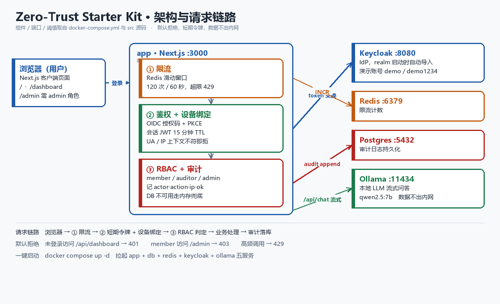

# Zero-Trust Starter Kit

> 一个生产级、开箱即用的**零信任全栈脚手架**：OIDC 鉴权 + RBAC 权限 + 审计日志 + API 限流 + 内置本地优先 AI 助手。

[](LICENSE) [](CONTRIBUTING.md)

**GitHub：** https://github.com/hyeayswait/zero-trust-starter  
**Gitee（国内镜像）：** https://gitee.com/hbaby-secover/zero-trust-starter

[English](#english) | [中文](#chinese)



<p align="center"><sub>架构与请求链路：每个 API 强制过 限流 → 短期令牌+设备绑定 → RBAC → 审计。<br>
组件、端口、阈值均取自 <code>docker-compose.yml</code> 与 <code>src/</code> 源码。</sub></p>

---

## Chinese

### 特性
- **零信任鉴权**：基于 OIDC 授权码流程（PKCE），外部 IdP 背书身份
- **短期令牌 + 设备绑定**：访问令牌 15 分钟 TTL，且绑定设备上下文，会话盗用即拒绝
- **默认最小权限 RBAC**：角色 → 权限映射，新用户默认 `member`
- **全链路审计**：每次 API 调用记录 actor / action / ip / 结果，持久化到 Postgres（DB 不可用时内存兜底）
- **API 限流**：基于 Redis 滑动窗口
- **内置 AI 助手**：本地优先 Ollama 流式问答，支持 RAG（数据不出内网）
- **安全头**：CSP / X-Frame-Options / Nosniff 等默认开启

### 快速开始

#### 方式一：本地轻量启动（推荐，无需 Docker）

```bash
npm install
cp .env.demo.example .env.demo
node scripts/run-demo.mjs
```

打开 **http://127.0.0.1:3000** ，账号 `demo`（角色 `admin,member`）。

内置两个本地服务替代外部依赖，**登录、鉴权、RBAC、审计、流式输出均为真实逻辑**：
`scripts/mock-idp.mjs`（完整 OIDC 协议 + RS256 签名）、`scripts/mock-ollama.mjs`（NDJSON 流式）。
详见 [docs/DEMO-QUICKSTART.md](docs/DEMO-QUICKSTART.md)。

#### 方式二：完整栈（Docker）

```bash
# 1. 生成 APP_SECRET 并填入 .env
#    PowerShell:
#    $b=New-Object byte[] 48; [System.Security.Cryptography.RandomNumberGenerator]::Create().GetBytes($b)
#    (($b|%{$_.ToString('x2')})-join '')
# 2. 启动（内置 Keycloak 自动导入 zerotrust realm，Ollama 自动拉取模型）
docker compose up --build
# 3. 打开 http://localhost:3000 → 用 OIDC 登录，测试账号 demo / demo1234
```

> 默认 OIDC 由内置 **Keycloak** 提供，无需注册任何外部账号。
> 若要换外部 IdP（Auth0/公司 IdP），改 `.env` 的 `OIDC_*` 三项即可。
> Keycloak 管理台: http://localhost:8080 （admin / admin）

### 已验证

以下链路在 Windows + Node 20 上实测通过（服务端审计日志可逐条核对）：

```
GET  /api/auth/login       307   跳转 IdP，PKCE 授权码流程
GET  /api/auth/callback    307   code 换 token，签发 15 分钟会话
     [AUDIT] {"actor":"demo","action":"auth.login","ok":true}
GET  /api/dashboard        200   需 dashboard:read 权限
GET  /api/admin            200   需 admin:read 权限（RBAC 生效）
POST /api/chat             200   Ollama 流式响应，逐字输出
```

`npm test` 覆盖 30 项配置与安全断言（JWT 闭环、RBAC 映射、CSP 策略、
Cookie 属性、依赖完整性、文件编码）。

### 目录结构
```
src/lib/auth      # OIDC 客户端、JWT 会话、RBAC 类型
src/lib/security  # 请求守卫、限流、零信任上下文校验
src/lib/ai        # Ollama 流式客户端、RAG 桩
src/lib/audit     # 审计日志
src/app/api       # login/callback/logout/me/dashboard/admin/chat/health
scripts/          # mock IdP / mock Ollama / 一键启动 / demo 抓帧
tests/            # JWT 闭环 + 配置安全回归测试
```

---

## English

### Features
- **Zero-Trust Auth**: OIDC authorization code flow with PKCE, identity backed by external IdP
- **Short-lived token + device binding**: 15-min access token TTL, bound to device context; stolen sessions are rejected
- **Least-privilege RBAC**: role → permission map, new users default to `member`
- **Full audit trail**: every API call logs actor / action / ip / result, persisted to Postgres (in-memory fallback)
- **API rate limiting**: Redis-backed sliding window
- **Built-in AI assistant**: local-first Ollama streaming chat with RAG (data stays on-prem)
- **Secure headers**: CSP / X-Frame-Options / Nosniff on by default

### Quick Start

#### Option 1: local lightweight mode (no Docker required)

```bash
npm install
cp .env.demo.example .env.demo
node scripts/run-demo.mjs
```

Open **http://127.0.0.1:3000** , account `demo` (roles `admin,member`).

Two bundled local services stand in for external dependencies, while **auth, RBAC,
audit and streaming are the real code paths**: `scripts/mock-idp.mjs` (full OIDC
protocol with RS256 signing) and `scripts/mock-ollama.mjs` (NDJSON streaming).
See [docs/DEMO-QUICKSTART.md](docs/DEMO-QUICKSTART.md).

#### Option 2: full stack (Docker)

```bash
cp .env.example .env      # then set APP_SECRET (>= 32 chars)
docker compose up --build
# open http://localhost:3000  (test account: demo / demo1234)
```

### Verified

The following flow was executed on Windows + Node 20 and confirmed against the
server-side audit log:

```
GET  /api/auth/login       307   PKCE authorization code flow
GET  /api/auth/callback    307   code -> token, 15-minute session issued
     [AUDIT] {"actor":"demo","action":"auth.login","ok":true}
GET  /api/dashboard        200   requires dashboard:read
GET  /api/admin            200   requires admin:read (RBAC enforced)
POST /api/chat             200   Ollama streaming, token-by-token output
```

`npm test` runs 30 assertions covering JWT round-trip, RBAC mapping, CSP policy,
cookie attributes, dependency integrity and file encoding.

### Why this gets stars
Most starters ship auth as an afterthought. This kit makes **zero-trust the default**:
secure headers, short-lived device-bound tokens, least-privilege RBAC and audit logging
are wired in from day one — and it bundles a local-first AI assistant so your data never
leaves the network.

---

## License
MIT
